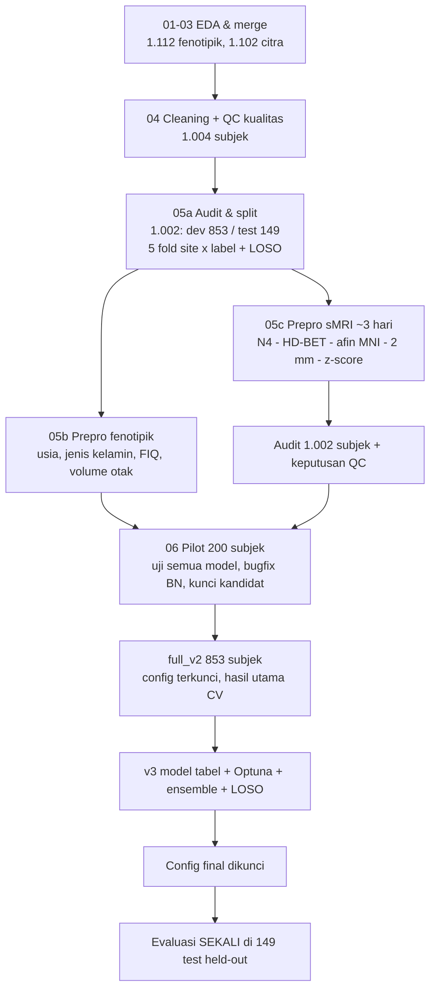

# Alur Pengerjaan & Hasil — Klasifikasi ASD vs TD (ABIDE I, sMRI T1w + Fenotipik)

Dokumen ini merangkum seluruh pengerjaan dari data mentah sampai evaluasi akhir: apa yang dilakukan di tiap tahap,
keputusan yang diambil (dan alasannya), output yang dihasilkan, serta di mana file-nya disimpan.
Terakhir diperbarui: 30-10-2026.

---

## 0. Ringkasan satu halaman

| | |
|---|---|
| **Tugas** | klasifikasi Autism Spectrum Disorder (ASD) vs Typically Developing (TD) |
| **Data** | ABIDE I: MRI struktural T1w + fenotipik (usia, jenis kelamin, IQ), 20 site/scanner |
| **Kohort** | 1.002 subjek lolos QC & preprocessing → **853 dev** (CV 5-fold) + **149 test held-out** (dievaluasi sekali di akhir) |
| **Model final** | ensemble rata-rata probabilitas: TabM fenotipik + LogReg ROI + EfficientNet-B0 2.5D + CNN 3D (dipilih dari skor inner validation) |
| **Hasil CV dev (853)** | accuracy **0,660** [0,628–0,691], AUC **0,692** [0,656–0,727] |
| **Hasil TEST (149)** | accuracy **0,597** [0,517–0,678], BA 0,592, AUC **0,657** [0,566–0,745] (threshold 0,5); sensitivitas 0,522 / spesifisitas 0,662 |
| **Pesan utama** | sinyal ASD di T1w + fenotipik lemah tapi nyata (±60–66 % accuracy dengan validasi bersih multi-site); efek site jauh lebih besar dari efek diagnosis; menggabungkan modalitas lebih membantu daripada mengganti/men-tuning model |

---

## 1. Alur besar

Prinsip yang dijaga di semua tahap: **(1)** semua yang dipelajari (imputasi, scaling, ComBat, PCA, seleksi, tuning) di-fit
hanya pada data latih tiap fold; **(2)** model/threshold/anggota ensemble dipilih dari *inner validation*, bukan skor test;
**(3)** config dikunci (hash) sebelum run dan tidak diubah setelah melihat hasil; **(4)** SITE_ID dan instrumen diagnostik
(ADOS, ADI-R, SRS, SCQ, AQ, DSM) tidak pernah jadi fitur; **(5)** 149 subjek test tidak disentuh sampai evaluasi akhir;
**(6)** semua percobaan dicatat, termasuk yang gagal.

---

## 2. Tahap demi tahap

### 2.1 EDA, merge, cleaning (notebook 01–04)
- **Data awal**: CSV fenotipik 1.112 subjek; 1.102 punya citra T1w (10 tidak punya citra).
- **QC teknis**: tidak ada file rusak/kosong/non-finite. **QC kualitas** (rating PCP): 98 subjek dibuang → **1.004 subjek**
  (ASD 469 / TD 535). Kegagalan "skull-stripping fail" dari pipeline PCP tidak dihitung sebagai citra buruk (karena itu
  kegagalan alat PCP, bukan kualitas scan).
- Nilai `-9999` dikonversi ke `NaN` (2.044 sel); semua eksklusi dicatat dengan alasan (`cleaning_log.csv`).
- **Output**: `dataset/cleaned_dataset/` (`cleaned_master_dataset.csv`, `data_dictionary.csv`, `cleaning_log.csv`,
  `smri_qc.csv`), ringkasan di `insight/01-04.md`.

### 2.2 Audit & split (05a)
- Audit menemukan **2 subjek UM_1 (50279, 50286) dengan citra identik** (hash voxel sama) tetapi fenotipik berbeda →
  keduanya dibuang karena pemilik citra tidak bisa ditentukan → **1.002 subjek** (`data/drop_log.csv`).
- **Split**: 149 subjek test held-out (69 ASD) disisihkan; 853 dev (398 ASD) dibagi **5 fold stratified site × label**
  (`fold_strat`), plus kolom `loso_site`/`loso_eligible` untuk leave-one-site-out.
- Di dalam tiap fold: 20 % data latih jadi *inner validation* (seed 42) untuk early stopping & seleksi.
- **Output**: `data/folds.csv`, `results/full_v2/splits.json`, notebook `05a_audit_folds.ipynb`.

### 2.3 Preprocessing fenotipik (05b)
- Fitur dipakai: **AGE_AT_SCAN, SEX, FIQ, volume_mask_ml** (volume otak dari mask HD-BET). Aturan: fitur dipakai bila
  selisih % missing ASD vs TD ≤ 10 poin (FIQ: selisih 0,5 poin → dipakai).
- Imputasi & scaling di-fit di data latih tiap fold.
- **Output**: `data/pheno_clean.csv`, `data/missing_decision.csv`, notebook `05b_preprocessing_phenotype.ipynb`.

### 2.4 Preprocessing sMRI (05c, ±3 hari komputasi)
- **Pipeline 05c-v2.1** (fingerprint `682404ae0f5d2624`): reorient RAS → N4 bias correction → **HD-BET** skull stripping
  (GPU, deterministik) → registrasi **afin ANTs** ke MNI152 1 mm (seed 42, 1 thread) → resample 2 mm →
  crop **96 × 112 × 96** → z-score di dalam mask.
- **Masalah yang ditemukan & diperbaiki**: registrasi ANTs tidak deterministik dengan banyak thread → dikunci 1 thread;
  HD-BET non-deterministik (cuDNN benchmark) → dibuat deterministik. Output config lama disimpan di `_superseded/`.
- **Bukti kualitas**: audit konsistensi 1.002 subjek **lulus** (satu fingerprint, versi alat seragam, semua output valid,
  QC pilot vs batch baru tidak berbeda); 4 subjek diulang dari nol → **identik bitwise**; 149 subjek test tidak muncul di
  file hasil modeling mana pun.
- **Keputusan QC**: 10 subjek outlier statistik → **KEEP** (montase direview: skull stripping & registrasi baik);
  50404 → citra KEEP, `volume_mask_ml` = missing (header voxel janggal).
- **Output**: citra di Hugging Face `feliciacyntia/abide1-smri-prepro` (853 dev); `data/smri_preproc/` (status, QC,
  log per subjek, audit, keputusan QC); kode `src/smri_preprocessing.py`, `src/run_05c.py`.

### 2.5 Pilot 20 % (200 subjek dev) — uji coba
- Semua kandidat diuji: fenotipik (LogReg, XGBoost, MLP, TabM), ROI Harvard-Oxford (± ComBat), citra 2.5D pretrained
  (EfficientNet-B0, ResNet18, ConvNeXt-V2, DINOv2), citra 3D (SFCN pretrained, CNN 3D+SE dari nol), CNN 2.5D dari nol,
  fusion (stacking / rata-rata / PCA) dan ensemble.
- **Bug ditemukan**: CNN dari nol "gagal" karena statistik BatchNorm basi saat evaluasi → **bugfix** (kalibrasi ulang BN dari
  inner_train tanpa augmentasi). CNN 3D naik dari BA 0,45 ke 0,56 (di data penuh). Hasil lama ditandai tidak valid, tidak dihapus.
- **Dikeluarkan** (berdasarkan inner validation / cek kewajaran, bukan skor test): SFCN (gagal cek usia otak, r = −0,13),
  DINOv2 dan ConvNeXt-V2 (AUC inner terendah; ConvNeXt 5× lebih mahal), XGBoost (di bawah kandidat lain).
- Threshold **Youden dari inner validation** dikunci sebagai pelengkap (0,5 tetap utama).
- **Output**: `results/pilot200*`, `results/pilot200_v2/locked_config_kandidat.json`, notebook 06–08 (bagian pilot).

### 2.6 Data penuh full_v2 (853 subjek) — hasil utama CV pertama
- Semua kandidat terkunci dilatih ulang dari nol (91 unit, ±3,7 jam), config hash `560c89845312e371`.

| Model | Accuracy | BA | AUC |
|---|---|---|---|
| LogReg fenotipik (baseline) | 0,574 | 0,574 | 0,598 |
| TabM fenotipik | 0,601 | 0,595 | 0,624 |
| TabM ROI + ComBat | 0,599 | 0,597 | 0,620 |
| EfficientNet-B0 2.5D | 0,571 | 0,571 | 0,591 |
| CNN 3D dari nol | 0,551 | 0,556 | 0,567 |
| ResNet18 / CNN 2.5D dari nol | 0,488 / 0,521 | ≈ acak | ≈ acak |
| **Fusion fenotipik + ROI (stacking, terkunci)** | **0,628** | **0,624** | **0,664** |

- Fusion utama **signifikan lebih baik** dari baseline (McNemar, Holm p = 0,040).
- **Site learning**: embedding citra menebak site dengan BA 0,71 (acak 0,05); ComBat menurunkannya ke 0,17 tetapi performa
  ASD tidak berubah. **Kurva belajar** (20 → 100 % data latih): LogReg fenotipik datar (AUC ±0,60), TabM fenotipik & ROI
  naik sedikit (0,60 → 0,63), fusion fenotipik + ROI naik paling jelas (0,59 → 0,67) — data lebih banyak membantu fusion.
- **Output**: `results/full_v2/report/` (metrik + CI, confusion matrix, ROC, McNemar, per site, kurva belajar,
  pilot vs penuh), notebook 06 Bagian B.

### 2.7 v3 — model tabel lanjutan, tuning, ensemble, LOSO
- Config dikunci sebelum run (`results/v3/locked_config_v3.json`, sha256 `4521259311445664…`); 288 unit, tidak ada yang gagal.
- **E1**: LogReg (C dari inner CV), TabM (5 seed), CatBoost, **TabPFN v2** untuk fenotipik & ROI.
  **E3**: tuning **Optuna** 30 trial nested (AUC inner CV 3-fold di data latih tiap fold) untuk LogReg/TabM/CatBoost.
- **Seleksi (skor inner)**: TabM fenotipik (tuned) dan LogReg ROI (tuned); citra dari full_v2: EfficientNet-B0 dan CNN 3D.

| Model (CV dev, 853) | Accuracy [95 % CI] | AUC |
|---|---|---|
| Model tunggal v3 (semua varian) | 0,576–0,606 | 0,600–0,639 |
| Ensemble tabel (fenotipik + ROI) | 0,657 [0,624–0,688] | 0,686 |
| **Ensemble utama (fenotipik + ROI + 2.5D + 3D)** | **0,660 [0,628–0,691]** | **0,692** |
| Pembanding full_v2 fusion | 0,628 [0,596–0,659] | 0,664 |

- Kenaikan vs full_v2 (+3,2 poin accuracy, +0,028 AUC): p DeLong 0,027 / McNemar 0,043 tanpa koreksi, **tidak signifikan
  setelah Holm** (19 perbandingan) → dilaporkan sebagai tren.
- **LOSO (18 site)**: ensemble tabel turun ke accuracy 0,606 pada site yang tidak pernah dilihat (5-fold pada subjek sama 0,653);
  per site 0,40 (Stanford) – 0,77 (OHSU). Penurunan terbesar di ROI (intensitas peka scanner).
- **Konfounder**: probabilitas prediksi berkorelasi kuat dengan **FIQ** (ρ hingga −0,56, juga di dalam kelompok ASD saja
  dan TD saja) dan volume otak; tidak dengan usia.
- **Output**: `results/v3/report/` (V1–V6 + gambar), notebook 06 Bagian C.

### 2.8 Evaluasi final — 149 subjek test held-out (sekali)
- Config final dikunci **sebelum** test dibuka: `results/final/locked_config_final.json` (sha256 `9f5dc684…`).
- Prediksi test = rerata 5 model fold yang sudah dilatih (TabM: juga 5 seed); tidak ada pelatihan ulang/pilihan baru.
- Sebelum test diprediksi, pipeline mereproduksi prediksi fold-CV yang tersimpan: **selisih maks ±1e-16** (identik).
- Fitur ROI test diekstrak dengan fungsi & atlas yang sama (deterministik).

**Hasil (dijalankan sekali, 30-10-2026; 149 subjek, 69 ASD / 80 TD):**

| Model | Threshold | Accuracy [95 % CI] | BA | AUC [95 % CI] | Sens | Spes |
|---|---|---|---|---|---|---|
| **ENS_utama (model final)** | 0,5 | **0,597** [0,517–0,678] | 0,592 | **0,657** [0,566–0,745] | 0,522 | 0,662 |
| ENS_utama (model final) | Youden 0,519 | 0,611 [0,530–0,691] | 0,598 | 0,657 | 0,420 | 0,775 |
| ENS_tabel (fenotipik + ROI) | 0,5 | 0,604 [0,523–0,685] | 0,597 | 0,658 [0,565–0,746] | 0,507 | 0,688 |
| full_v2 fusion PR | 0,5 | 0,604 [0,523–0,685] | 0,593 | 0,644 [0,549–0,731] | 0,449 | 0,738 |
| anggota: TabM fenotipik | 0,5 | 0,611 | 0,601 | 0,618 | 0,464 | 0,738 |
| anggota: LogReg ROI | 0,5 | 0,557 | 0,550 | 0,593 | 0,449 | 0,650 |
| anggota: EfficientNet-B0 2.5D | 0,5 | 0,617 | 0,613 | 0,602 | 0,551 | 0,675 |
| anggota: CNN 3D dari nol | 0,5 | 0,564 | 0,562 | 0,535 | 0,536 | 0,588 |

Confusion matrix model final (0,5): TN 53, FP 27, FN 33, TP 36.

| Model | Accuracy CV dev (853) | Accuracy TEST (149) | AUC CV dev | AUC TEST |
|---|---|---|---|---|
| ENS_utama (model final) | 0,660 | 0,597 | 0,692 | 0,657 |
| ENS_tabel | 0,657 | 0,604 | 0,686 | 0,658 |
| full_v2 fusion PR | 0,628 | 0,604 | 0,664 | 0,644 |

- **Model final vs fusion full_v2 di test**: AUC 0,657 vs 0,644 (DeLong p = 0,48); accuracy 0,597 vs 0,604
  (McNemar p = 1,0; 10 vs 11 subjek yang hanya benar di salah satu model) → **tidak berbeda**.
- **Interpretasi**: performa test lebih rendah dari CV (accuracy −6 poin, AUC −0,035), tetapi AUC CV masih di dalam CI test
  dan AUC test jauh di atas acak (batas bawah CI 0,566). Penurunan konsisten dengan (a) optimisme kecil akibat banyak
  perbandingan/seleksi di data dev yang sama dan (b) variasi sampling n = 149 (CI ±0,08). Keunggulan ensemble utama atas
  fusion full_v2 yang terlihat di CV (tren, tidak signifikan setelah Holm) **tidak terulang** di test — semua model
  gabungan modalitas berada di kisaran sama (accuracy ±0,60, AUC ±0,65).
- Threshold Youden (dari inner) menaikkan accuracy sedikit (0,611) dengan menggeser ke spesifisitas tinggi; threshold
  utama tetap 0,5 sesuai config.
- Per site (n 4–28 per site) terlalu kecil untuk ditafsirkan; tabel di `metrik_test_per_site.csv`.
- **Output**: `results/final/` — `ringkasan_final.md`, `metrik_test.csv`, `cv_vs_test.csv`, `uji_final_vs_fusion.json`,
  `metrik_test_per_site.csv`, `heldout_predictions.csv`, `reproduksi_fold_cv.csv`, `test_roc_cm.png`, log run.

---

## 3. Insight utama
1. **Akurasi ±60–66 % adalah angka realistis untuk ABIDE multi-site dengan validasi bersih.** Angka 80–90 % di literatur umumnya
   dari satu site, sampel kecil, atau kebocoran data (split per-slice, seleksi fitur/ComBat di luar fold).
2. **Efek site ≫ efek diagnosis**: di data pilot, site menjelaskan ±42 % variasi fitur ROI, diagnosis ±0,4 % (notebook 08);
   di data penuh, embedding citra menebak site jauh lebih baik (BA 0,71) daripada menebak ASD.
3. **Menggabungkan modalitas** (fenotipik + ROI + citra) adalah pengungkit terbesar; mengganti model (TabPFN, CatBoost) atau
   tuning hampir tidak berpengaruh.
4. **Citra T1w afin saja lemah** (accuracy 0,55–0,57); CNN pretrained 2D lebih stabil dari CNN dari nol.
5. **Generalisasi ke scanner baru** menurunkan accuracy ±5 poin (LOSO).
6. **IQ adalah konfounder penting**: sebagian sinyal model berasal dari FIQ/ukuran otak, bukan hanya morfologi khas ASD.
7. Bug teknis (BatchNorm, non-determinisme registrasi/HD-BET) bisa mengubah kesimpulan — sanity check & uji reproducibility wajib.
8. **Hasil test independen** (accuracy 0,597, AUC 0,657) mengonfirmasi sinyal nyata di atas acak, tetapi sedikit di bawah CV;
   ensemble 4 modalitas tidak lebih baik dari fusion fenotipik + ROI yang lebih sederhana di test.

## 4. Keterbatasan
- Registrasi hanya afin (bukan non-linear) → fitur ROI berbasis intensitas, bukan volume/ketebalan.
- Stacking cabang citra dilatih pada inner holdout (±136 subjek/fold), bukan OOF inner CV.
- Konfounder FIQ dan site belum dihilangkan; label test publik (fenotipik ABIDE) sehingga pengaman test berupa prosedur.
- n test 149 → CI lebar (±0,08); uji di test bersifat deskriptif.
- Erratum config v3: teks menulis LOSO 20 site; data aktual 18 site (812 subjek).

## 5. Peta file

| Isi | Lokasi |
|---|---|
| Kode | `src/` (preprocessing `smri_preprocessing.py`/`run_05c.py`; modeling `run_pilot_v2.py`, `run_v3_tabular.py`; analisis `analysis_full_v2.py`, `analysis_v3.py`; evaluasi akhir `final_eval.py`) |
| Notebook & laporan | `notebook/01–08` (+ HTML 06/07/08) — 06 = laporan teknis (pilot, Bagian B data penuh, Bagian C v3, lampiran audit), 07 = ringkasan untuk dosen |
| Data tabel | `dataset/cleaned_dataset/`, `data/folds.csv`, `data/pheno_clean.csv`, `data/smri_preproc/` (QC, status, log, audit) |
| Citra hasil preprocessing | HF dataset `feliciacyntia/abide1-smri-prepro` (lokal: `C:\ta_local\data\smri_preproc`) |
| Hasil | `results/pilot200*`, `results/full_v2/`, `results/v3/`, `results/final/` (config terkunci, prediksi, tabel, gambar) |
| Checkpoint model | HF model `feliciacyntia/abide1-asd-results` (upload oleh pemilik TA) |

## 6. Reproduksi
Lihat README bagian "Setup untuk melanjutkan modeling". Ringkas: clone repo → `hf download feliciacyntia/abide1-smri-prepro
--repo-type dataset --local-dir data\smri_preproc` → `pip install -r requirements-model.txt` → set `TA06_IMAGE_ROOT`,
`TA06_RESULTS_ROOT` → jalankan runner (`--resume`, file `STOP`, `--stop-at`). Clone bersih sudah diuji (data, runner tabel,
runner citra; epoch 1 identik dengan run asli).

## 7. Langkah berikutnya: menambah data time series (rs-fMRI)
- Sumber: **ABIDE Preprocessed (PCP)** — time series ROI (mis. atlas CC200/AAL/Harvard-Oxford) dari pipeline C-PAC;
  fitur utama = **matriks konektivitas fungsional** (korelasi antar ROI, transformasi Fisher-z, vektor segitiga atas).
- Cek dulu **irisan subjek**: tidak semua subjek sMRI punya rs-fMRI lolos QC; pakai `folds.csv` yang sama agar hasil
  sebanding, dan tangani subjek tanpa fMRI (missing modality) secara eksplisit.
- Model: LogReg/SVM linear pada konektivitas (C dari inner CV), lalu fusion dengan ensemble sMRI+fenotipik (rerata probabilitas).
  ComBat konektivitas di-fit di train fold.
- **Evaluasi**: bandingkan di **CV dev** dengan hasil CV model final ini (accuracy 0,660 / AUC 0,692). Test 149 sudah dipakai
  untuk model sMRI+fenotipik; bila model rs-fMRI juga dites di sana, laporkan **terpisah sebagai analisis tambahan (post-hoc)**.
